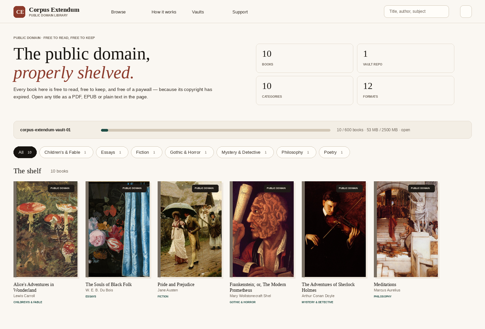
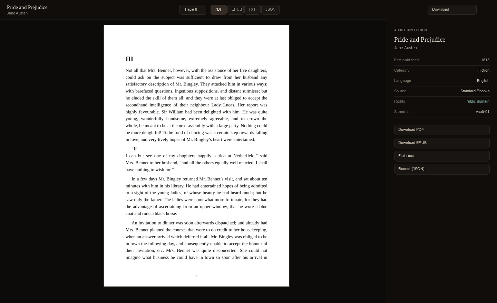

<div align="center">

# Corpus Extendum

**The public domain, properly shelved.**

A free library of out-of-copyright books. Read them in the page as a PDF, an EPUB or plain text; download anything; keep it forever. No accounts, no tracking, no paywall — because the copyright has expired, not because someone is being generous.

[](https://drsamonline.github.io/corpus-extendum/)
[](data/catalog.json)
[](#what-opens-in-the-page)
[](LICENSE)
[](#running-it)
[](#running-it)

</div>



---

## What this is

Ten books, ten categories, one shelf that grows by itself. Every title is public domain in **both India and the United States** — the stricter of the two tests is the one that gates a book — and each record says on what basis, so you can audit the claim instead of trusting it.

- **Read in the page.** PDF, EPUB and plain text all open inside the library. No plugin, no "download to view", no new tab.
- **One book, one card.** A title that exists as PDF, EPUB and text is a single entry with format chips, not three near-duplicate entries. The dedupe gate refuses a second copy before it is ever fetched.
- **Nothing to sign up for.** No accounts, no cookies, no analytics, no email capture. A library that cannot sell you anything does not need to know who you are.



---

## The shelf

| # | Book | Author | Year | Category | Source |
|---|---|---|---|---|---|
| 1 | Pride and Prejudice | Jane Austen | 1813 | Fiction | Standard Ebooks |
| 2 | Frankenstein; or, The Modern Prometheus | Mary Wollstonecraft Shelley | 1818 | Gothic & Horror | Standard Ebooks |
| 3 | The Adventures of Sherlock Holmes | Arthur Conan Doyle | 1892 | Mystery & Detective | Standard Ebooks |
| 4 | The Time Machine | H. G. Wells | 1895 | Science Fiction | Standard Ebooks |
| 5 | Meditations | Marcus Aurelius · trans. George Long | c. 180 | Philosophy | Standard Ebooks |
| 6 | Gitanjali | Rabindranath Tagore | 1912 | Poetry | Standard Ebooks |
| 7 | The Song Celestial; or, Bhagavad-Gita | trans. Sir Edwin Arnold | 1885 | Sacred Texts | Gutenberg mirror |
| 8 | The Souls of Black Folk | W. E. B. Du Bois | 1903 | Essays | Standard Ebooks |
| 9 | Dubliners | James Joyce | 1914 | Short Stories | Standard Ebooks |
| 10 | Alice's Adventures in Wonderland | Lewis Carroll | 1865 | Children's & Fable | Standard Ebooks |

Every record — title, author, translator, year, subjects, source URL, rights basis, file hashes — is in [`data/catalog.json`](data/catalog.json), and the same list is in [`index.txt`](index.txt) for anyone who would rather read it without a browser.

---

## How a book gets on this shelf

**01 · Fetch.** Text and artwork come from Standard Ebooks where an edition exists (their editions are CC0, and their typesetting is far better than a raw dump), from the Gutenberg mirror otherwise, and from archive.org for a scan that exists nowhere else.

**02 · Verify.** Author's death year + 60 for India, publication year for the US. Both must pass, or the book is refused. Translations are gated on the translator's death year, because the English text is the translator's work.

**03 · Build.** A PDF is typeset for the screen, the source EPUB is kept, text is extracted for in-book search, plates are downscaled, and two hashes are stored: one for the file, one for the normalised text.

**04 · Shelve.** Files are committed to the open vault repo, its `index.txt` is rewritten, and the catalogue picks the book up on the next scan.

### Duplicates are refused twice

Before fetching, the source reference is checked against `data/dedupe.json`. At ingest, the hash of the **normalised text** — boilerplate stripped, lowercased, punctuation and page numbers removed — decides what this actually is:

| Test | Catches | Action |
|---|---|---|
| source ref | the same ebook pulled twice | refuse, never fetched |
| text hash | the same text from a different source | merge formats into the existing record |
| work key | a different edition of the same work | merge as an edition |
| trigram ≥ 0.92 + same author | near-duplicates the hashes missed | hold for review, never auto-add |

Nothing is ever added on a fuzzy match. A false duplicate is a book missing from the shelf; a missed duplicate is a library that lies about its size — the gate prefers the first.

---

## What opens in the page

| Format | Viewer | In-book search |
|---|---|---|
| PDF | pdf.js | yes |
| EPUB | epub.js | yes |
| TXT | text pager | yes |
| Markdown | renderer | yes |
| HTML | sandboxed frame | yes |
| JSON / XML | collapsible tree | yes |
| CSV / TSV | table viewer | yes |
| Images · Audio · Video · CBZ | native players | — |

MOBI, AZW3, DjVu, DOCX, ODT, RTF, CBR and archives are **converted at ingest** and never served raw. If the library cannot open a file in the page, it does not shelve it — it converts it first.

The renderers are vendored in `assets/vendor/` and lazy-loaded per format, so opening a text file downloads no PDF engine. Nothing on a reading page comes from a third party.

---

## Vaults

Books do not live in this repository. They live in vault repos — `corpus-extendum-vault-01`, `-02`, … — each holding `books/<slug>/` with its PDF, EPUB, text, cover and record, plus its own `index.txt` and `manifest.json`.

A vault seals at **600 books or 2.5 GB**, whichever comes first, and the next one opens. This repo holds only HTML, JSON and the catalogue, so it stays a few hundred kilobytes forever.

Vaults are deliberately **not** GitHub Pages sites: Pages caps a published site at 1 GB, and a 2.5 GB vault would never fit. Books are served through jsDelivr and `raw.githubusercontent.com` instead, which also spreads the bandwidth.

---

## Running it

```bash
# shelve a book (idempotent, and refuses duplicates)
python3 scripts/ingest.py --vault ../corpus-extendum-vault-01 --only 1342

# a whole batch
python3 scripts/ingest.py --vault ../corpus-extendum-vault-01 --only 84,1661,35

# rebuild the catalogue, the indexes and the search tokens
python3 scripts/build_catalog.py --vault ../corpus-extendum-vault-01

# regenerate the README screenshots from the real shelf
python3 scripts/make_shots.py --vault ../corpus-extendum-vault-01
```

Needs Python 3.11+, `weasyprint` and `pillow`. No other dependencies — the GitHub calls are `urllib`, the tarballs come from codeload so there is no API rate limit, and the site itself is plain HTML, CSS and JS with no build step.

Serve it locally with anything:

```bash
python3 -m http.server 8000    # then open http://localhost:8000
```

---

## Why not fetch from gutenberg.org directly

It refuses datacenter IPs — every request from a cloud runner we have tried comes back `403`, including plain file paths. So the pipeline reads Standard Ebooks and the GITenberg mirror, both served by GitHub, and does not depend on being run from a residential connection.

---

<div align="center">

## Keep the shelf open

No ads, no accounts, no analytics, nothing for sale. If this library is useful to you, you can help pay for the next batch of books — the scanning, the typesetting and the bandwidth are all paid for out of pocket.

[](https://github.com/sponsors/drsamonline)


<sub>Built by [Sohil Momin](https://github.com/drsamonline) · [UPI QR](docs/assets/upi-qr.svg) for direct support</sub>

</div>

---

## Licence

The **texts** are public domain. Our **typesetting, covers, catalogue records and metadata** are released under [CC0 1.0](LICENSE) — a library that gates its own catalogue behind a licence has misunderstood the assignment. Attribution to each source edition stays on every record, permanently. See [NOTICE.md](NOTICE.md) for what came from where.
